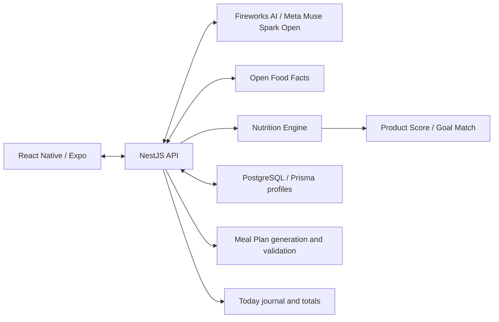

# FoodLens

**Scan. Understand. Track. Plan.**

FoodLens is a mobile nutrition application built for the **Meta Global AI Developer Hackathon**. It combines Meta-powered food recognition and meal generation with a deterministic Nutrition Engine, Product Score, Goal Match, and daily tracking.

The current Meta configuration uses **Meta Muse Spark Open through Fireworks AI** for all four primary AI workflows: **Label Scan, Product Scan, Meal Scan, and Meal Plan**. The application has been exercised on a real iPhone, including Meal Scan and Add to Today.

## What you can do

| Workflow | Current primary AI / data source | Result |
|---|---|---|
| **Label Scan** | Meta Muse Spark Open | Read a nutrition-label photo; normalize available nutrients and return Product Score and Goal Match. |
| **Product Scan** | Open Food Facts + Meta Muse Spark Open when needed | Identify a packaged product by barcode, retrieve source data, and analyze relevant photos when the existing completeness rules require it. |
| **Meal Scan** | Meta Muse Spark Open | Estimate a prepared meal's components, portion weights, calories, protein, carbohydrates, fat, and calorie range from one photo. |
| **Meal Plan** | Meta Muse Spark Open | Generate a one-day plan for the user's targets and dietary restrictions, then validate it in application code. |
| **Today** | Application logic | Add a Meal Scan result to the day's journal and view calorie and macro totals against personal targets. |

A nutrition profile supplies age, biological sex, height, weight, activity level, goal, dietary preferences, allergens, and avoided ingredients. Supported goals are weight loss, weight maintenance, weight gain, and eating healthier. Dietary preferences include no restriction, vegetarian, vegan, and pescatarian.

## How Meta is used

The API calls the Fireworks chat-completions endpoint with the fixed model identifier:

```text
Model:    accounts/fireworks/models/muse-spark-open
Endpoint: https://api.fireworks.ai/inference/v1/chat/completions
```

Vision requests send images to the server-side provider as image data. The adapters reuse the established task prompts and JSON contracts, validate model responses, and pass accepted data to the existing normalizers. The model does not replace the nutrition or scoring engines.

Provider selection is explicit and independent for each workflow. Authentication errors, timeouts, invalid JSON, and truncated responses do **not** silently switch a Meta request to Gemini. Meal Plan retains its existing single corrective generation, when validation requires it, using the same selected provider.

Google Gemini remains technically available as an alternative in the provider layer. The four flags below select Meta for the primary workflows; they are not a claim that Google code has been removed. The checked-in defaults and legacy selectors do not all default to Fireworks, so set every flag explicitly when reproducing the Meta configuration.

Product text extraction and ingredient translation follow the selected Product provider. Label's display-only translation follows its own `LABEL_SCAN_AI_PROVIDER`: Fireworks / Meta when set to `fireworks`, or the existing Gemini helper when explicitly set to `google`. Translation failures preserve the existing original-text fallback without switching models. An optional AI-assisted Goal Match evaluator remains in code; the documented configuration keeps it disabled with `GOAL_MATCH_AI=off` and uses the application's own scoring algorithms.

## Product Scan: barcode first, AI when needed

The existing Product Scan sequence is preserved:

```text
Barcode -> Open Food Facts -> optional configured enrichment
        -> photo analysis only when needed and suitable photos are available
        -> normalization and disclosed estimates -> Product Score + Goal Match
```

- A sufficiently complete Open Food Facts result skips unnecessary photo analysis. A successful barcode lookup does not force a new Meta vision request.
- For an unknown or incomplete product, the existing rules can request a nutrition-label photo or analyze supplied nutrition/ingredient photos. Without a barcode, Product Scan starts from the supplied photo.
- Optional enrichment can fill verified gaps after product/variant matching. Tavily discovers pages when configured; the selected Product AI performs text extraction where required. FatSecret is available only with its separate credentials.
- A photo-analysis error can retain usable database information under the existing rules. This is a data-source fallback, not a switch to another AI model.
- Ingredient display translation may make a separate text request even when vision analysis was unnecessary. Existing lookup and translation caches remain in place; there is no server-side final vision-result cache.

The merge and normalization pipeline retains source provenance, observed values, unknown fields, and explicitly marked estimates. English ingredient display is separate from the original source list and preserves its order, percentages, E-numbers, and nesting when translation passes validation. Missing ingredients are not manufactured to complete a list. Allergen inference uses supported ingredient terms; missing allergen information is unknown, not evidence that a product is allergen-free.

Label Scan is a separate path: it reads the supplied nutrition-label photo and bypasses barcode and database lookup. It can leave ingredients or allergens unknown when they are not visible.

## Nutrition and scoring

**Product Score and the active Goal Match path are FoodLens algorithms, not ratings invented by an AI model.** AI may supply extracted facts or semantic evidence; the application validates and normalizes those inputs before scoring.

| Component | Responsibility |
|---|---|
| **Nutrition Engine** | Calculate daily energy and macro targets from the profile; normalize source data; disclose missing-nutrient estimates; check plausibility. |
| **Product Score** | Calculate a general 0-10 product score using nutrition, protein, fiber, sugar, saturated fat, salt, additives, and processing evidence. Return explanatory factors and confidence. |
| **Goal Match** | Calculate a personalized 0-10 fit using the product, serving context, targets, goal, and restrictions, with uncertainty and safety/quality guards. |
| **Meal Scan normalization** | Reject or drop implausible components under existing rules, reconcile component calories with macros, and sum accepted components into meal totals. |
| **Meal Plan validation** | Check generated meals against dietary preferences, allergens, avoided ingredients, portion bounds, and daily calorie/macro tolerances. |
| **Today** | Sum journal entries and compare totals with the user's calculated daily targets. |

Scores depend on available data and profile context. They can be partial or unavailable; example scores for named products are not fixed product properties. Prepared-meal photo estimates do not receive a packaged-product Product Score or Goal Match.

## Meal planning and daily tracking

Meal Plan creates one day with three meals or four meals including a snack. It uses the profile's daily targets and restrictions, recent suggested meal names, and a variation hint. It does not currently replan dinner from the food already logged in Today.

The server computes plan totals and validates the response. A plan with a detected dietary restriction violation is rejected. A safe plan with calorie or macro deviations can be returned with `withinTargets=false`. The latest plan is cached for the current profile in API memory; opening it again does not itself generate another AI request.

Meal Scan returns `{ estimate }` with recognized components, approximate weights, totals, confidence, a calorie range, and assumptions. **Add to Today** uses that result without another AI request. A stable entry ID prevents duplicate additions after a retry. In the current mobile UI, this add action is implemented for Meal Scan results; packaged-product results are not yet an Add to Today flow.

## Architecture

FoodLens is a TypeScript monorepo:

```text
apps/
  mobile/       React Native, Expo, Expo Router
  api/          NestJS REST API and workflow orchestration
packages/
  ai/           Typed providers, prompts, JSON schemas, Fireworks and alternative adapters
  core/         Shared domain types, contracts, feature flags, and common calculations
  nutrition/    Nutrition Engine, meal normalization, and dietary/target validation
  scoring/      Product Score and Goal Match algorithms
  database/     Prisma client and PostgreSQL profile persistence
```



PostgreSQL stores nutrition profiles. Today entries, the latest meal plan, variety history, and workflow caches currently live in API memory and reset on restart. Photos are handled in memory for analysis rather than stored by the scan endpoints. The API currently uses one local demo-user identity; production authentication and durable journal storage are not implemented.

## Run locally

### Prerequisites

- Node.js **22.23.4** was used for local verification. The root manifest declares Node.js 20 or newer, but use a version compatible with the pinned Expo/Prisma dependencies and Node's `process.loadEnvFile` API.
- pnpm **10.28.0**, as pinned in `package.json`.
- Docker with Docker Compose for the included PostgreSQL service.
- An iPhone or Android device with a compatible Expo Go installation or development build.
- A Fireworks API key with access to the model above. Local tests use fixtures; running real scan/generation actions can incur API charges.

### 1. Clone and prepare environment files

```bash
git clone https://github.com/Sarakaev98/foodlens.git
cd foodlens
git switch main
cp apps/api/.env.example apps/api/.env
cp packages/database/.env.example packages/database/.env
cp apps/mobile/.env.example apps/mobile/.env
```

In PowerShell, use `Copy-Item` instead of `cp` if preferred. Copy these files only for a fresh setup; preserve existing local settings.

Keep the matching local `DATABASE_URL` values from the API and database examples when using the included Docker service. In **`apps/api/.env`**, explicitly set:

```dotenv
FIREWORKS_API_KEY=replace-with-your-fireworks-api-key
LABEL_SCAN_AI_PROVIDER=fireworks
PRODUCT_SCAN_AI_PROVIDER=fireworks
MEAL_SCAN_AI_PROVIDER=fireworks
MEAL_PLAN_PROVIDER=fireworks
GOAL_MATCH_AI=off
PRODUCT_LOOKUP=open_food_facts
```

The key above is a placeholder. Keep real credentials server-side. Never put keys in the mobile environment, `EXPO_PUBLIC_*`, source files, logs, or Git. Local `.env` files are ignored; `.env.example` contains documentation and placeholders only.

These explicit settings override the legacy selectors for the four primary workflows. `AI_PROVIDER=meta` refers to the older Meta Model API adapter, **not** Fireworks. `SCAN_AI_PROVIDER` is a legacy Product alias used only when `PRODUCT_SCAN_AI_PROVIDER` is absent. To select Gemini for one primary workflow, set its flag to `google` and supply the server-side `GOOGLE_API_KEY` and `GOOGLE_CLOUD_PROJECT` settings; no automatic model fallback is enabled.

Optional configuration:

- `WEB_SEARCH_LOOKUP=tavily` and `TAVILY_API_KEY` enable the existing page-search enrichment. Leave enrichment off for a minimal setup. Product Fireworks cannot use Gemini's native Google Search Grounding mode; use the existing Tavily path when web discovery is required.
- `OFF_CONTACT` supplies a project contact for Open Food Facts requests.
- `FIREWORKS_SCAN_TIMEOUT_MS=60000`, `FIREWORKS_MEAL_SCAN_TIMEOUT_MS=45000`, and `FIREWORKS_MEAL_PLAN_TIMEOUT_MS=60000` document the current default deadlines.
- Feature overrides such as `FEATURE_MEAL_PHOTO` and `EXPO_PUBLIC_FEATURE_MEAL_PHOTO` control exposure of features; the shared defaults are enabled.

### 2. Install dependencies and initialize PostgreSQL

```bash
pnpm install
docker compose up -d
pnpm db:generate
pnpm db:deploy
```

`db:deploy` applies the checked-in migrations. Use `pnpm db:migrate` when developing schema changes, rather than for this normal setup.

### 3. Start the API and mobile app

Run these from the repository root in separate terminals:

```bash
# Terminal 1
pnpm dev:api
```

```bash
# Terminal 2
pnpm dev:mobile
```

The API defaults to port 3000. Open `http://localhost:3000/health`; a ready server returns `{"status":"ok"}`. This health check does not call a model and does not verify database migrations or Fireworks access.

For a physical phone, put it on the same network as the computer. The mobile app normally derives the API host from the Expo development server. If needed, set the following in **`apps/mobile/.env`** and restart Expo:

```dotenv
EXPO_PUBLIC_API_URL=http://YOUR_COMPUTER_LAN_IP:3000
```

Use the computer's LAN address, not the phone's `localhost`. Verify `/health` from the phone before a scan, and allow the local API port through the firewall if required. Complete the nutrition-profile onboarding before testing personalized targets or Meal Plan. A real model test should be one deliberate Analyze/Create Plan action, with no repeated taps while it runs.

## API surface

| Endpoint | Purpose |
|---|---|
| `GET /health` | Process health; no AI request. |
| `GET /profile`, `PUT /profile` | Read or save the current demo user's nutrition profile. |
| `GET /nutrition-targets` | Calculate targets from that profile. |
| `POST /scan/analyze` | Product or Label Scan; Label uses `mode=nutrition_label`. |
| `POST /scan/meal` | Analyze one prepared-meal photo. |
| `GET /meal-plan` | Read the latest cached plan. |
| `POST /meal-plan/generate` | Generate a new daily plan; optional `mealsPerDay` is 3 or 4. |
| `GET /today?date=YYYY-MM-DD`, `POST /today/entries` | Read the journal or add a deduplicated meal entry. |

## Verification and diagnostics

The Meta integration was verified with **1,591 passing automated tests**, plus TypeScript checking and the API production build. The tests cover provider isolation, unchanged prompts/contracts, barcode/OFF behavior, ingredient and allergen regressions, nutrition normalization, scoring, restrictions, errors/timeouts, meal planning, mobile behavior, and Add to Today. This is the integration verification snapshot, not a promise that the count will remain fixed.

```bash
pnpm test
pnpm typecheck
pnpm build
```

These checks use mocked model responses and do not require live Fireworks requests. `pnpm build` builds the shared packages and API; it does not produce an iOS or Android release binary.

For a production-mode local API process after building:

```bash
pnpm --filter @foodlens/api start
```

Provider diagnostics record the selected provider/model, request IDs, HTTP stage timings, token usage, and estimated cost when available. Cost estimates can differ from billing. Normalization logs explain rejected or adjusted meal components. Never enable raw credential, image, or model-body logging for a demo.

Photo-derived nutrition is approximate, database records can be incomplete, and dietary checks cover recognized terms rather than every possible ingredient synonym. These limitations are surfaced through missing data, provenance, confidence, ranges, and validation outcomes rather than a guarantee of complete recognition.

## Implementation references

- [Label Scan provider routing](docs/fireworks-label-scan.md)
- [Product Scan flow and provider selection](docs/fireworks-product-scan.md)
- [Meal Scan contract, diagnostics, and controlled test](docs/fireworks-meal-scan.md)
- [Meal Plan Fireworks adapter](packages/ai/src/providers/fireworks/fireworks-meal-plan-provider.ts)
- [Nutrition Engine](packages/nutrition/src/index.ts)
- [Product Score implementation](packages/scoring/src/score-product.ts)
- [Goal Match implementation](packages/scoring/src/match-goal.ts)
- [Shared feature flags](packages/core/src/feature-flags/feature-flags.ts)

FoodLens connects food recognition with explicit nutrition calculations, understandable product scores, daily tracking, and personalized planning in one mobile workflow.
